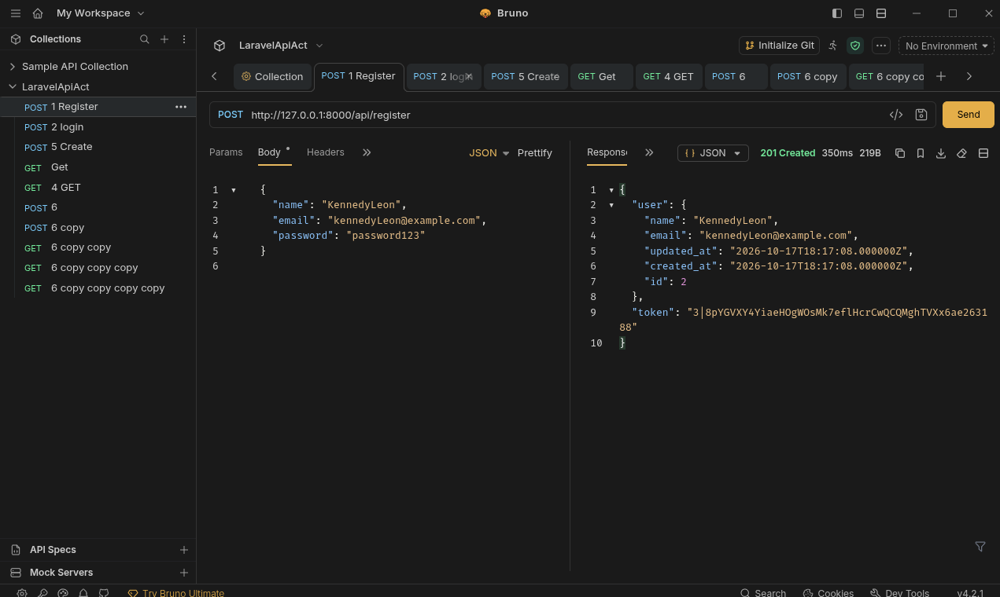
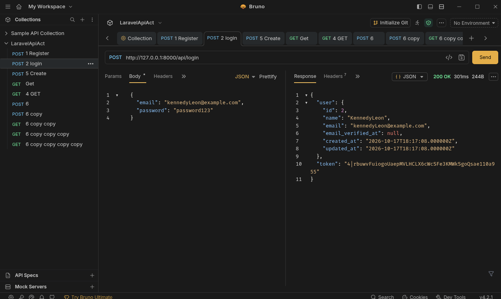
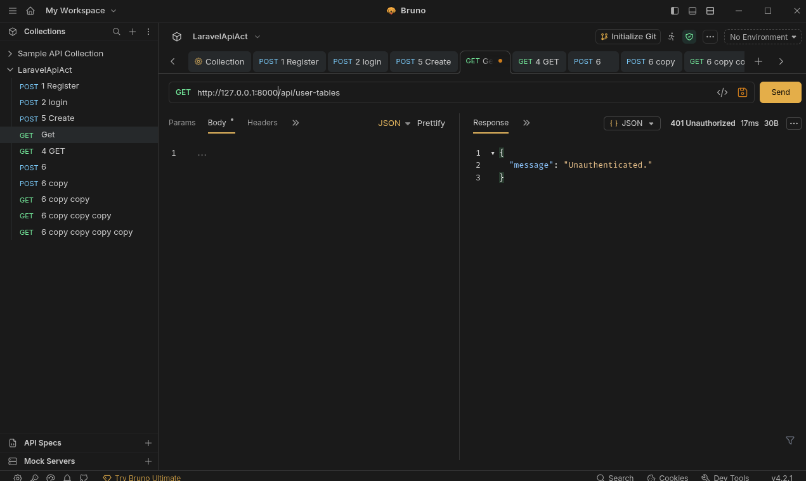
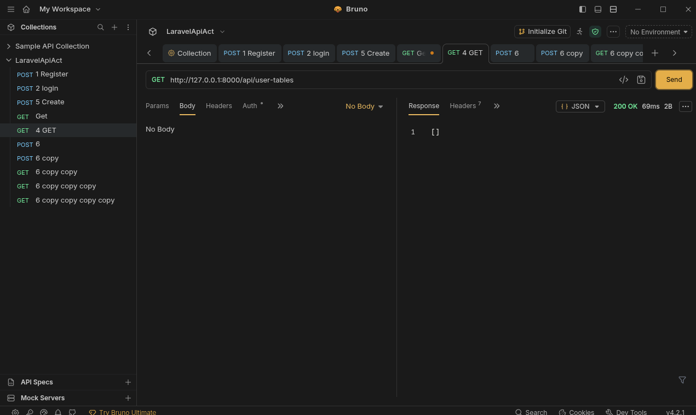
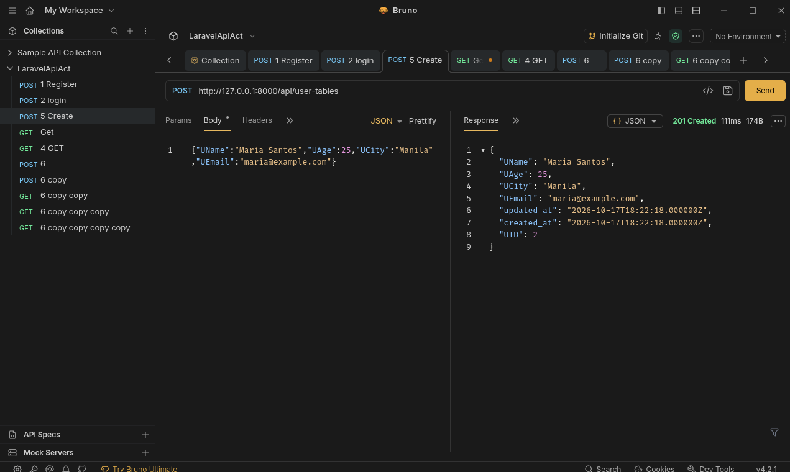
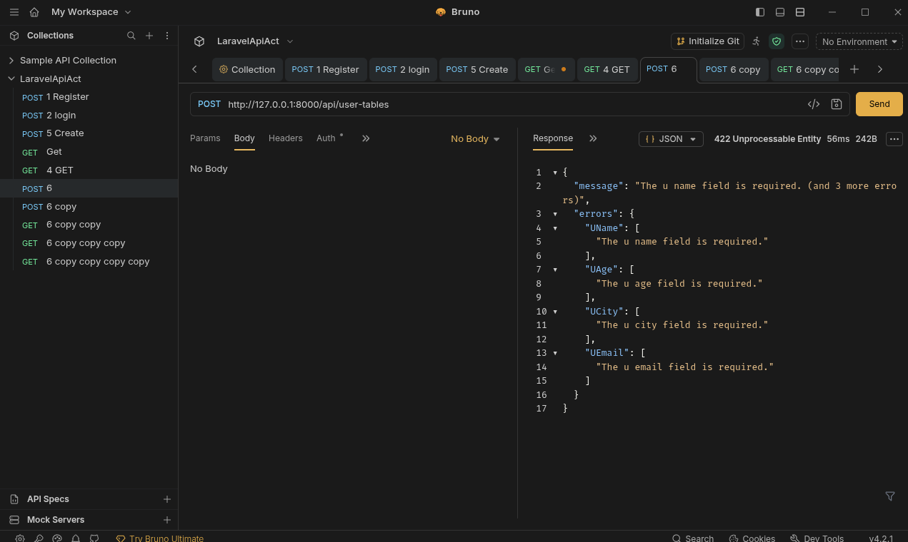
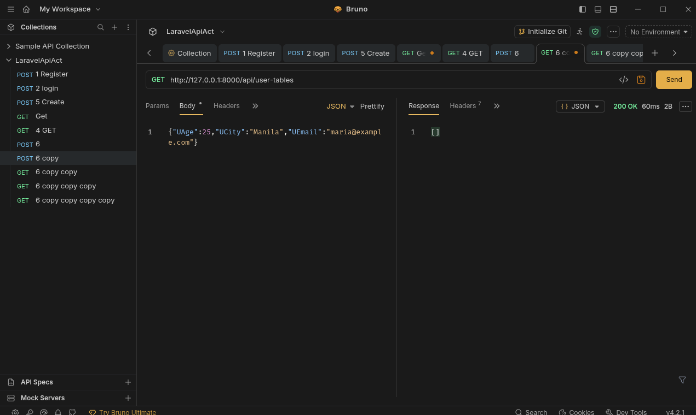
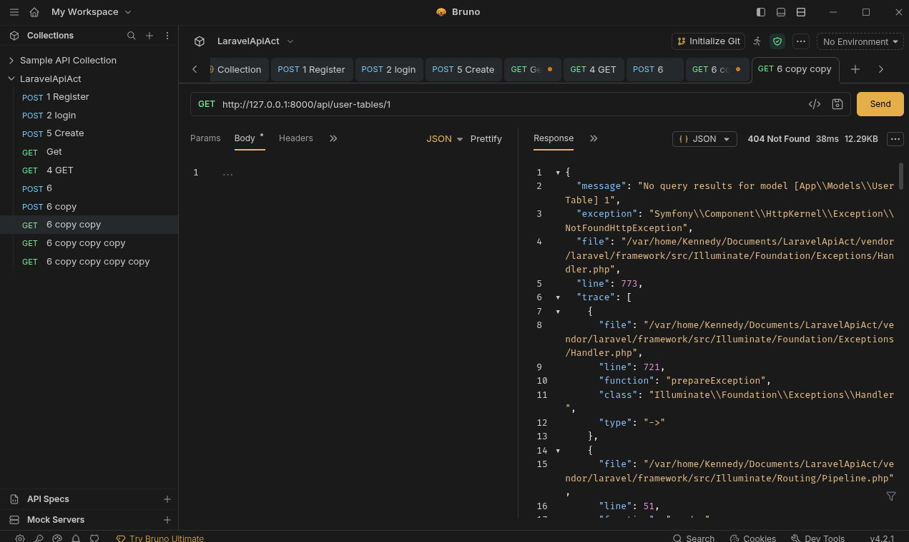
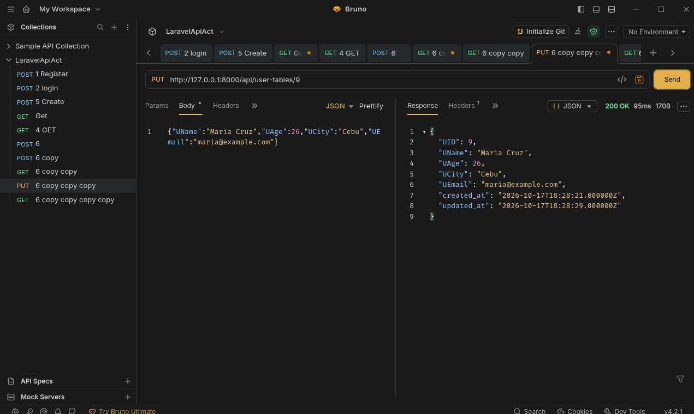
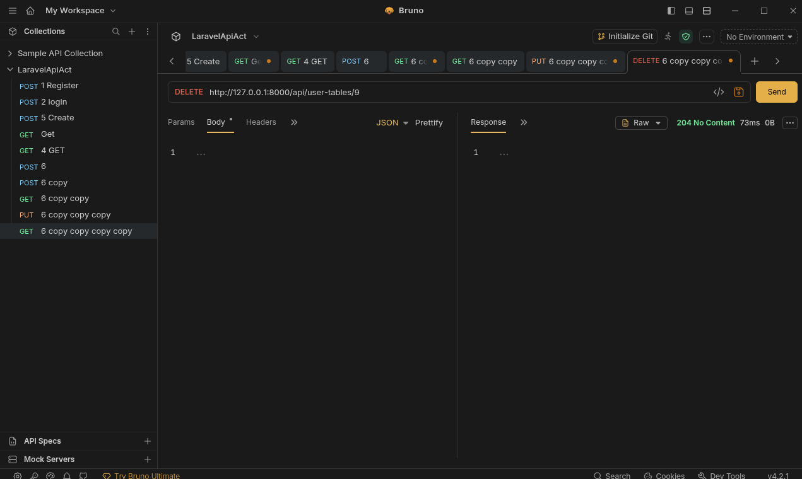

# User Table API

**Partners:** Poala Barroso (solo)
**Section:** IT2E
**Resource:** UserTable (fields: UName, UAge, UCity, UEmail)

## Setup

```
git clone https://github.com/<username>/<repo-name>.git
cd <repo-name>
composer install
cp .env.example .env
php artisan key:generate
touch database/database.sqlite
php artisan migrate
php artisan serve
```

The API runs at `http://127.0.0.1:8000/api`. Send the header `Accept: application/json` on every request.

## Routes

| Verb | Path | What it does | Token? |
|------|------|--------------|--------|
| POST | /api/register | Create account, returns token | No |
| POST | /api/login | Log in, returns token | No |
| POST | /api/logout | Revoke current token | Yes |
| GET | /api/me | Show logged-in user | Yes |
| GET | /api/user-tables | List records (filter by UName, UAge, UCity, UEmail) | Yes |
| POST | /api/user-tables | Create a record | Yes |
| GET | /api/user-tables/{userTable} | Show one record | Yes |
| PUT | /api/user-tables/{userTable} | Update a record | Yes |
| DELETE | /api/user-tables/{userTable} | Delete a record | Yes |

## Screenshots

### 1. Register (201)


### 2. Login (200)


### 3. List with no token (401)


### 4. List with token (200)


### 5. Create (201)


### 6. Create with missing field (422)


### 7. Show one (200)


### 8. Show missing record (404)


### 9. Update (200)


### 10. Delete (204)


## Why does DELETE return 204 and not 200?

Because DELETE returns 204 meaning the body doesnt have any anything in it. 
So a 204 status code just means that it work. A 200 status code usually 
has a body, like the record returned from a GET or PUT, so 204 tells 
the client the record/s that removed was successfully deleted instead of 
wondering if why it return with no body.
